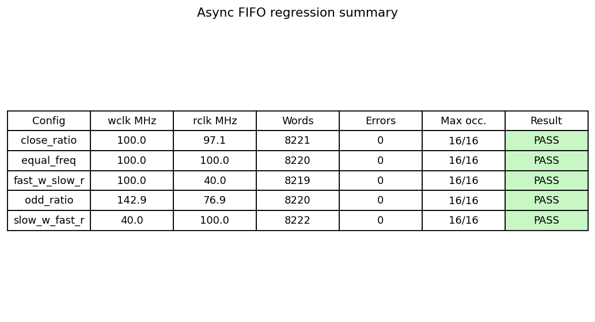
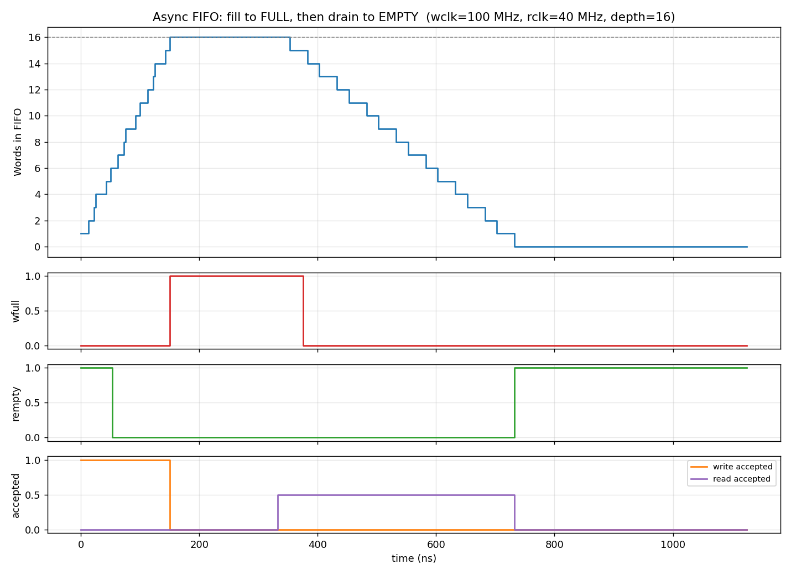

# Asynchronous FIFO (Gray-code pointers, 2-FF synchronizers)

A parameterizable asynchronous FIFO in Verilog, with a self-checking testbench, regression across five
clock-frequency ratios, mutation tests, and result plots. Design style follows the well-known
Cummings "Simulation and Synthesis Techniques for Asynchronous FIFO Design" approach.

## Architecture

```
 write domain (wclk)                         read domain (rclk)
 +-----------------+   wptr_gray --[2FF]-->  +-----------------+
 |  wptr_full      |                         |  rptr_empty     |
 |  (wbin, wgray,  | <--[2FF]-- rptr_gray    |  (rbin, rgray,  |
 |   wfull)        |                         |   rempty)       |
 +--------+--------+                         +--------+--------+
          | waddr                                     | raddr
          v                                           v
                 +-------------------------------+
                 |  fifo_mem (dual-port RAM)     |---> rdata
 wdata --------> |  write @wclk, async read      |
                 +-------------------------------+
```

| File | Purpose |
|---|---|
| `rtl/async_fifo.v`  | Top level, parameters `DATA_WIDTH` (8), `ADDR_WIDTH` (4 -> depth 16) |
| `rtl/fifo_mem.v`    | Dual-port memory, write on `wclk`, combinational read |
| `rtl/wptr_full.v`   | Write pointer (binary + Gray), `wfull` generation |
| `rtl/rptr_empty.v`  | Read pointer (binary + Gray), `rempty` generation |
| `rtl/sync_2ff.v`    | 2-flop synchronizer for the Gray-coded pointers |
| `tb/tb_async_fifo.v`| Self-checking testbench with scoreboard |
| `run_sim.sh`        | Runs the regression (5 clock configs) |
| `plot_results.py`   | Makes the PNG plots / summary table from the logs |

### Key design ideas
1. **Pointers are N+1 bits.** The extra MSB tells "full" from "empty" when the low bits are equal.
2. **Gray code across clock domains.** Only one bit changes per increment, so a pointer sampled
   mid-transition is off by at most one count and never a wildly wrong value.
3. **Two-flop synchronizers** reduce metastability risk on the crossing.
4. **Flags are pessimistic, never optimistic.** `wfull` / `rempty` may stay asserted a few cycles
   longer than strictly needed (synchronizer latency), but never de-assert too early, so the FIFO
   can't overflow or underflow.
5. **FULL**: next write Gray pointer == synced read Gray pointer with the top two bits inverted.
   **EMPTY**: next read Gray pointer == synced write Gray pointer.

## How to run

```bash
sudo apt install iverilog        # or install Icarus Verilog on Windows / use MSYS2
./run_sim.sh                     # runs everything, logs in results/
python3 plot_results.py          # optional: regenerate plots (needs matplotlib)
gtkwave results/fast_w_slow_r.vcd   # optional: view waveforms
```

## Tests (all in `tb/tb_async_fifo.v`)

1. Reset: `rempty=1`, `wfull=0`
2. Fill to full, keep writing -> extra writes blocked (exactly DEPTH accepted)
3. Drain to empty, keep reading -> extra reads blocked, data order checked
4. Random traffic, balanced (60% / 60%)
5. Write-heavy (95% / 25%), FIFO runs full
6. Read-heavy (25% / 95%), FIFO runs empty
7. Continuous simultaneous read + write at 100%
8. Reset in the middle of traffic, then continued traffic

Every accepted write is stored in a scoreboard and every accepted read is compared to it,
so any data loss, duplication or reordering is reported as an error.

## Results

Simulator: Icarus Verilog 12.0. Each run transfers about 8,200 words.

| Config | wclk (MHz) | rclk (MHz) | Words transferred | Errors | Max occupancy | Result |
|---|---|---|---|---|---|---|
| fast_w_slow_r | 100.0 | 40.0  | 8219 | 0 | 16/16 | PASS |
| slow_w_fast_r | 40.0  | 100.0 | 8222 | 0 | 16/16 | PASS |
| close_ratio   | 100.0 | 97.1  | 8221 | 0 | 16/16 | PASS |
| equal_freq    | 100.0 | 100.0 | 8220 | 0 | 16/16 | PASS |
| odd_ratio     | 142.9 | 76.9  | 8220 | 0 | 16/16 | PASS |



Fill-then-drain behaviour (100 MHz write, 40 MHz read). Note that `rempty` falls about 2 read-clock
cycles after the first write, and `wfull` releases a little after the first read: that delay is the
synchronizer latency, and it is the intended "pessimistic flag" behaviour.



### Mutation tests
Three deliberately broken versions of the design were all caught by the testbench
(see `results/mutation_tests.md`), which shows the checks are actually effective.

## Limitations / notes
- Simulation only: no synthesis, timing or CDC-tool (e.g. SpyGlass) results are included.
  Metastability can't be modeled in plain RTL simulation.
- Reset de-assertion is not synchronized per domain; in a real design add reset synchronizers.
- Depth must be a power of 2 (Gray-code pointer wrap).
- Read data is combinational from the memory (`rdata` is valid whenever `rempty=0`).
